# DATABASE SCHEMA: AI-POWERED CUSTOMER FEEDBACK INTELLIGENCE PLATFORM

This document details the relational entity architecture, Mermaid ER diagram, table constraints, foreign key mappings, and indexing strategies.

---

## 1. Entity-Relationship (ER) Diagram

```mermaid
erDiagram
    Customer ||--o{ SurveyResponse : submits
    Customer ||--o{ Review : writes
    Customer ||--o{ Ticket : opens
    Customer ||--o{ SupportMessage : sends

    Product ||--o{ SurveyResponse : evaluates
    Product ||--o{ Review : reviews
    Product ||--o{ Ticket : relates_to
    Product ||--o{ SupportMessage : references
    Product ||--o{ ActionItem : targeted_by

    Channel ||--o{ SurveyResponse : conduits
    Channel ||--o{ Review : receives
    Channel ||--o{ Ticket : routes
    Channel ||--o{ SupportMessage : delivers

    Survey ||--o{ SurveyResponse : contains

    Ticket ||--o{ SupportMessage : threads

    Theme ||--o{ Theme : parent_of
    Theme ||--o{ FeedbackTheme : classifies
    Theme ||--o{ ActionItem : addresses

    ActionItem ||--o{ ActionFeedback : supported_by

    Customer {
        string customer_id PK
        string full_name
        string email UK
        string segment
        string country
        string loyalty_tier
        datetime created_at
    }

    Product {
        string product_id PK
        string product_name
        string category
        string sku UK
        float price
        datetime release_date
        boolean is_active
    }

    Channel {
        string channel_id PK
        string channel_name UK
        string channel_type
        string description
        boolean is_active
    }

    Survey {
        string survey_id PK
        string title
        string description
        string target_audience
        boolean is_active
        datetime created_at
    }

    Theme {
        string theme_id PK
        string theme_name UK
        string parent_theme_id FK
        text description
        text keywords
        string default_severity
        boolean is_active
        datetime effective_start_date
        datetime effective_end_date
    }

    SurveyResponse {
        string response_id PK
        string survey_id FK
        string customer_id FK
        string product_id FK
        string channel_id FK
        int rating
        text response_text
        datetime response_date
        string ground_truth_sentiment
        string ground_truth_theme_ids
    }

    Review {
        string review_id PK
        string customer_id FK
        string product_id FK
        string channel_id FK
        int rating
        string title
        text review_text
        datetime review_date
        boolean verified_purchase
        string ground_truth_sentiment
        string ground_truth_theme_ids
    }

    Ticket {
        string ticket_id PK
        string customer_id FK
        string product_id FK
        string channel_id FK
        string subject
        string status
        datetime created_at
        datetime resolved_at
    }

    SupportMessage {
        string message_id PK
        string ticket_id FK
        string customer_id FK
        string product_id FK
        string channel_id FK
        string sender_type
        text message_text
        datetime message_date
        string priority
        string ground_truth_sentiment
        string ground_truth_theme_ids
    }

    ActionItem {
        string action_id PK
        string theme_id FK
        string product_id FK
        float priority_score
        string priority_level
        text problem_description
        text recommended_action
        string assigned_team
        string owner
        string status
        string expected_impact
        text actual_impact
        datetime created_date
        datetime due_date
        datetime resolved_date
    }

    FeedbackTheme {
        int id PK
        string feedback_id
        string feedback_type
        string theme_id FK
        float confidence
        string classification_method
        string model_version
        boolean is_human_reviewed
        string reviewed_by
        datetime review_timestamp
    }

    FeedbackSentiment {
        int id PK
        string feedback_id
        string feedback_type
        string predicted_sentiment
        float confidence_score
        string model_version
        text explanation
        string review_status
        datetime processing_timestamp
    }

    ActionFeedback {
        int id PK
        string action_id FK
        string feedback_id
        string feedback_type
        datetime linked_date
    }

    StateChangeEvent {
        int id PK
        string entity_type
        string entity_id
        string previous_state
        string new_state
        string changed_by
        text change_reason
        datetime change_timestamp
    }

    DataQualityIssue {
        string issue_id PK
        string source_record_id
        string source_record_type
        string issue_type
        string severity
        text expected_result
        text actual_result
        datetime detection_timestamp
        string resolution_status
        text resolution_notes
    }

    SentimentShiftAlert {
        string alert_id PK
        string dimension_type
        string dimension_id
        datetime period_start
        datetime period_end
        float baseline_negative_rate
        float current_negative_rate
        float percentage_change
        int feedback_volume
        string severity
        text summary
        datetime detected_at
    }
```

---

## 2. Referential Integrity & Multiplicity

| Parent Entity | Child Entity | Relationship | Optionality | Cascade Action |
|---|---|---|---|---|
| Customer | SurveyResponse | 1 : N | Mandatory parent | CASCADE DELETE |
| Customer | Review | 1 : N | Mandatory parent | CASCADE DELETE |
| Customer | Ticket | 1 : N | Mandatory parent | CASCADE DELETE |
| Customer | SupportMessage | 1 : N | Mandatory parent | CASCADE DELETE |
| Product | SurveyResponse | 1 : N | Mandatory parent | RESTRICT |
| Product | Review | 1 : N | Mandatory parent | RESTRICT |
| Product | Ticket | 1 : N | Mandatory parent | RESTRICT |
| Product | ActionItem | 1 : N | Mandatory parent | RESTRICT |
| Channel | SurveyResponse | 1 : N | Mandatory parent | RESTRICT |
| Channel | Review | 1 : N | Mandatory parent | RESTRICT |
| Channel | Ticket | 1 : N | Mandatory parent | RESTRICT |
| Survey | SurveyResponse | 1 : N | Mandatory parent | CASCADE DELETE |
| Ticket | SupportMessage | 1 : N | Mandatory parent | CASCADE DELETE |
| Theme | FeedbackTheme | 1 : N | Mandatory parent | RESTRICT |
| Theme | ActionItem | 1 : N | Mandatory parent | RESTRICT |
| ActionItem | ActionFeedback | 1 : N | Mandatory parent | CASCADE DELETE |

---

## 3. Index Strategy

1. **Composite Unique Indices**:
   - `ix_feedback_theme_unique`: `(feedback_id, feedback_type, theme_id)` — Prevents duplicate theme assignments.
   - `ix_feedback_sentiment_unique`: `(feedback_id, feedback_type)` — Guarantees a single active sentiment classification per feedback record.
   - `ix_action_feedback_unique`: `(action_id, feedback_id, feedback_type)` — Avoids duplicate feedback linkage to an action item.

2. **Performance Query Indices**:
   - `ix_reviews_date_prod`: `(review_date, product_id)` — Accelerates time-series anomaly and trend aggregation.
   - `ix_survey_resp_date_prod`: `(response_date, product_id)` — Optimizes survey timeline queries.
   - `ix_dqi_status_sev`: `(resolution_status, severity)` — Speeds up data quality dashboard filters.
   - `ix_state_change_entity`: `(entity_type, entity_id)` — Enables sub-millisecond retrieval of action and feedback audit history.
